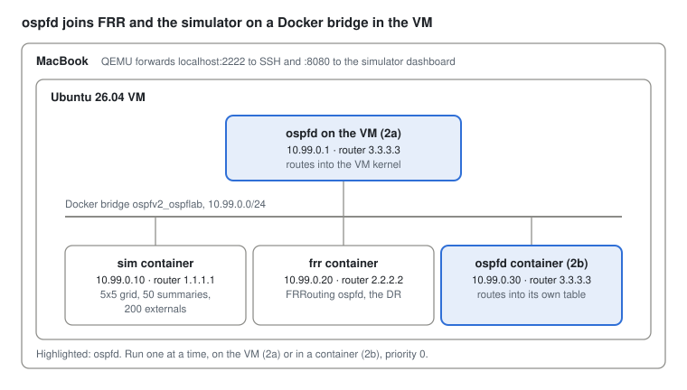

# ospfv2 user guide

How to run the demo, the `ospfd` router and `ospf-cli` from a Mac with Apple silicon: natively, in an Ubuntu VM under QEMU, and in Docker.

## Overview

The demo runs anywhere Ruby runs, including macOS. `ospfd` is Linux only, so on the Mac it runs in an Ubuntu ARM VM under QEMU, either directly or in Docker. `ospf-cli` runs wherever `ospfd` runs, and on the Mac through SSH.

| What | macOS | Ubuntu VM | Docker in the VM |
| --- | --- | --- | --- |
| Demo: `ospfv2 demo`, simulator against a built-in peer, no root | Yes | Yes | Yes |
| Simulator against FRR: `docker compose --profile frr` | No | Not covered here | Yes |
| Router: `ospfd`, needs raw sockets and netlink | No | Yes | Yes |
| CLI: `ospf-cli`, talks to `ospfd` over a Unix socket | Yes, through SSH | Yes | Yes, with `docker exec` |

The path through this guide:

1. Build the Ubuntu VM once (about 30 minutes, most of it the install).
2. Install Ruby, Docker and the repo in the VM.
3. Play with the demo, then the router lab, then the CLI.

A code block that starts with `# in the VM` runs at the VM's shell prompt. Log in with `ssh ospflab` first, then paste it. Blocks of show and set lines go at the ospf-cli prompt. Every other block runs on the Mac.

Tested on Linux x86 with version 1.0.0. The Mac steps (QEMU, rv, Homebrew) follow the QEMU, Ubuntu and rv docs.

## Ubuntu VM with QEMU

QEMU runs an Ubuntu 26.04 LTS arm64 server at native speed through Apple's Hypervisor framework (`-accel hvf`). You install it once from the ISO in a window, then run it headless and log in with SSH.

### 1. Install Homebrew and QEMU

Skip the first line if `brew --version` already works.

```sh
/bin/bash -c "$(curl -fsSL https://raw.githubusercontent.com/Homebrew/install/HEAD/install.sh)"
brew install qemu
qemu-system-aarch64 --version
ls /opt/homebrew/share/qemu/edk2-aarch64-code.fd
```

The last file is the UEFI firmware the VM boots from. Homebrew installs it with QEMU.

### 2. Get the ISO and make the disk

The ISO is about 3 GB. It comes from [Ubuntu Server for ARM](https://ubuntu.com/download/server/arm). If the direct link below fails, take the link from that page.

```sh
mkdir -p ~/vms/ospflab && cd ~/vms/ospflab
curl -LO https://cdimage.ubuntu.com/releases/26.04.1/release/ubuntu-26.04.1-live-server-arm64.iso
qemu-img create -f qcow2 disk.qcow2 40G
dd if=/dev/zero of=vars.fd bs=1m count=64
```

`disk.qcow2` grows as it fills, so 40G costs little at first. `vars.fd` keeps the firmware's settings, such as the boot entry the installer adds.

### 3. Install Ubuntu

This opens a window with the installer.

```sh
qemu-system-aarch64 \
  -machine virt -accel hvf -cpu host -smp 4 -m 4G \
  -drive if=pflash,format=raw,readonly=on,file=/opt/homebrew/share/qemu/edk2-aarch64-code.fd \
  -drive if=pflash,format=raw,file=vars.fd \
  -drive if=none,id=disk,format=qcow2,file=disk.qcow2 \
  -device virtio-blk-pci,drive=disk,bootindex=1 \
  -drive if=none,id=iso,format=raw,readonly=on,file=ubuntu-26.04.1-live-server-arm64.iso \
  -device virtio-blk-pci,drive=iso,bootindex=2 \
  -device virtio-gpu-pci -display default,show-cursor=on \
  -device qemu-xhci -device usb-kbd -device usb-tablet \
  -nic user,model=virtio-net-pci,hostfwd=tcp:127.0.0.1:2222-:22
```

Choose "Try or Install Ubuntu Server" and answer the installer:

- Network: keep the DHCP address (10.0.2.15). QEMU's user network gives the VM internet through the Mac.
- Storage: use the entire disk. The defaults are fine.
- Profile: server name `ospflab`, your user name (this guide uses `jm`), a password.
- SSH: tick "Install OpenSSH server".
- Featured snaps: pick none. Docker comes from apt later.

When it says "Reboot now", choose it, then close the QEMU window once the screen goes blank. From now on the VM boots from its disk without the ISO.

### 4. Start it headless

Save this as `~/vms/ospflab/start.sh` and run `chmod +x start.sh` once.

```sh
#!/bin/zsh
cd "$(dirname "$0")"
exec qemu-system-aarch64 \
  -machine virt -accel hvf -cpu host -smp 4 -m 4G \
  -drive if=pflash,format=raw,readonly=on,file=/opt/homebrew/share/qemu/edk2-aarch64-code.fd \
  -drive if=pflash,format=raw,file=vars.fd \
  -drive if=none,id=disk,format=qcow2,file=disk.qcow2 \
  -device virtio-blk-pci,drive=disk \
  -nic user,model=virtio-net-pci,hostfwd=tcp:127.0.0.1:2222-:22,hostfwd=tcp:127.0.0.1:8080-:8080,hostfwd=tcp:127.0.0.1:8081-:8081 \
  -display none -daemonize -pidfile vm.pid
```

`~/vms/ospflab/start.sh` returns at once and the VM boots in the background in about 20 seconds. The `hostfwd` entries map ports on the Mac to the VM: 2222 to SSH, 8080 and 8081 to the web dashboards. They listen on 127.0.0.1 only, so nothing outside the Mac reaches the VM.

### 5. Log in with SSH

Add this to `~/.ssh/config` on the Mac:

```
Host ospflab
  HostName 127.0.0.1
  Port 2222
  User jm
```

Then copy your key once, so you are not asked for the password every time. Run `ssh-keygen -t ed25519` first if you have no key yet.

```sh
ssh-copy-id ospflab
ssh ospflab
```

### 6. Sudo without a password

`ospfd` and `ospf-cli` need root, and `ssh ospflab sudo poweroff` cannot ask for a password. In the VM:

```sh
# in the VM, as your own user
echo "$USER ALL=(ALL) NOPASSWD: ALL" | sudo tee /etc/sudoers.d/90-$USER
sudo chmod 440 /etc/sudoers.d/90-$USER
sudo visudo -c                        # must print "parsed OK" for every file
sudo -k && sudo true                  # no password prompt means it works
```

Run it as your own user, not in a root shell such as `sudo -i`. There `$USER` is `root`, and the rule goes to the wrong account.

That `sudo tee` asks for your password one last time. `visudo -c` checks the syntax: a broken sudoers file can lock you out of `sudo`. If it reports an error, fix or delete the file in the same session with `sudo rm /etc/sudoers.d/90-$USER`.

This is fine for a lab VM that only the Mac can reach. Do not do it on a machine others can log in to.

### 7. Stop it and keep snapshots

```sh
ssh ospflab sudo poweroff                              # clean shutdown
qemu-img snapshot -c fresh ~/vms/ospflab/disk.qcow2   # snapshot, VM off
qemu-img snapshot -l ~/vms/ospflab/disk.qcow2         # list them
qemu-img snapshot -a fresh ~/vms/ospflab/disk.qcow2   # go back to one
```

Take a snapshot after the install and another after the next section. Going back costs seconds.

If QEMU will not start and its error mentions the address size or IPA, add `,highmem=off` after `-machine virt` and lower the memory to `-m 3G`. That was needed on early Apple chips with older QEMU releases.

## Ruby, Docker and the repo

ospfv2 uses the Ruby standard library only, so there are no gems to install. Ruby 3.2 or newer is enough.

### In the VM

```sh
# in the VM
sudo apt update
sudo apt install -y git ruby docker-compose-v2 docker-buildx tcpdump
sudo usermod -aG docker $USER
sudo mkdir -p /etc/iproute2/rt_protos.d
echo '89 ospfv2' | sudo tee /etc/iproute2/rt_protos.d/ospfv2.conf
exit                                      # log out: the docker group applies at the next login
```

`docker-compose-v2` pulls in Docker itself. The group change lets you run `docker` without `sudo`; it applies from your next login, which is why the block ends with `exit`. The last line makes `ip route` print `proto ospfv2` instead of `proto 89` on our routes.

#### Check Docker and the docker group

Log back in with `ssh ospflab`, then:

```sh
# in the VM
groups                                # must list docker
systemctl is-active docker            # must print active
docker buildx version                 # BuildKit, the current builder
docker run --rm hello-world           # prints "Hello from Docker!"
```

If `groups` has no `docker`, add yourself and log in again:

```sh
# in the VM
sudo groupadd -f docker               # the group, if the package did not make it
sudo usermod -aG docker $USER
exit                                  # then ssh ospflab again
```

`newgrp docker` applies the group to the current shell only, without logging out. If Docker is not active, `sudo systemctl enable --now docker` starts it now and at every boot.

If `docker buildx version` fails, install it. Without it Docker falls back to the old builder, warns that it is deprecated, and prints `Step 12/12` style output.

```sh
# in the VM
sudo apt install -y docker-buildx
docker buildx version
```

Then get the code:

```sh
# in the VM
ruby -v                                   # 3.3 on Ubuntu 26.04
git clone https://github.com/jeanmichel-gh/ospfv2.git
cd ospfv2
```

To run the unit tests (optional, about a minute):

```sh
# in the VM, from ~/ospfv2
ruby -Ilib -Itest -e 'Dir["test/unit/**/*_test.rb"].each { |f| require "./#{f}" }'
```

If it says it cannot load `test/unit`, run `sudo gem install test-unit` and try again.

### On the Mac

Only for the demo and for `ospf-cli`. Any Ruby 3.2 or newer works; with [rv](https://github.com/spinel-coop/rv):

```sh
cd ~/path/to/ospfv2                 # your clone
git pull
rv ruby list                        # need 3.2 or newer
rv ruby install latest              # only if the list has none
ruby -v
```

If your shell does not pick up the rv Ruby, prefix the commands in this guide with `rv run`, for example `rv run ruby bin/ospfv2 demo`.

## The demo

The demo floods a simulated area (a grid of routers, summaries and externals, 44 LSAs) to a built-in peer that plays the router under test. Both live in one Ruby process on an in-memory segment, so it needs no root, no network and no router. The adjacency is Full in about 10 seconds.

### On the Mac

```sh
cd ~/path/to/ospfv2
bin/ospfv2 demo --web 8090
```

Open http://localhost:8090. Port 8090, not 8080, because the VM holds 8080 on the Mac while it runs. Ctrl-C stops the demo.

Without `--web` you get the console instead:

```
bin/ospfv2 demo
ospf> state                  # neighbor state, LSA counts
ospf> links                  # links with id and state
ospf> down 3                 # take link 3 down
ospf> flap 3, count: 5, interval: 10
ospf> lsdb :ios              # the database, Cisco style
ospf> exit
```

### In the VM

```sh
# in the VM
cd ~/ospfv2
bin/ospfv2 demo --web 0.0.0.0:8080
```

Open http://localhost:8080 on the Mac. The `0.0.0.0` matters: the dashboard listens on 127.0.0.1 by default, which QEMU's port forward cannot reach.

### With Docker in the VM

#### Build the image

The repo's `Dockerfile` builds one image for the demo, the simulator and `ospfd`. It starts from the official `ruby:4.0-slim` image, copies the code to `/app` and puts `/app/bin` on the path. No gems are needed. On the M4 VM it builds a native arm64 image.

```sh
# in the VM
cd ~/ospfv2
docker build -t ospfv2 .                       # about a minute the first time
docker images ospfv2                           # the image and its size
docker run --rm ospfv2 --help                  # ospfv2 1.0.0 and its commands
docker run --rm ospfv2 check /app/examples/grid.yml
```

#### One image, one entrypoint per role

The `ospfv2` image holds three programs, one per role. `--entrypoint` picks which one a container runs; with none it runs the simulator. Name each container after its role, so `docker ps`, `docker logs` and `docker exec` read the same way.

| Role | Entrypoint | Container name | Example |
| --- | --- | --- | --- |
| Demo | `ospfv2` (the default) | `demo` | `docker run --rm --name demo -p 8080:8080 ospfv2` |
| Simulator in the router lab | `ospfv2` (the default) | `sim`, as compose names it: `ospfv2-sim-1` | `docker compose --profile frr up -d sim frr` |
| OSPF daemon | `--entrypoint ospfd` | `ospfd`, as compose names it: `ospfv2-ospfd-1` | `docker compose up -d ospfd`, section 2b of the router |
| OSPF CLI | `ospf-cli` | none: it runs inside the `ospfd` container | `docker compose exec ospfd ospf-cli` |

The CLI talks to the daemon over a Unix socket inside that container, so it runs there with `docker exec` rather than in a container of its own. Each program prints its options with `--help`:

```sh
# in the VM
docker run --rm ospfv2 --help
docker run --rm --entrypoint ospfd ospfv2 --help
docker run --rm --entrypoint ospf-cli ospfv2 --help
```

Build again after each `git pull`; Docker reuses the unchanged layers, so it takes seconds.

#### Run the tests in the image

The `Dockerfile` has three stages: `base` (Ruby 4.0 and the code), `test` (base plus the tests, run by a `RUN` step) and `runtime` (base plus the entrypoint, the image you use). `docker build -t ospfv2 .` builds `runtime` and skips the tests. `--target test` builds the `test` stage instead, so the tests run in the same Ruby, Debian and arm64 image you ship. A failing test fails the build. CI runs the same command.

Docker caches each step. When nothing changed it prints `CACHED` and the tests do not run again; `--no-cache` forces them.

```sh
# in the VM, from ~/ospfv2
docker build --target test --progress=plain -t ospfv2:test .              # tests, with every output line
docker build --target test --progress=plain --no-cache -t ospfv2:test .   # run them again even if nothing changed
docker build --build-arg RUBY_VERSION=3.4 -t ospfv2:ruby3.4 .   # the image on another Ruby
```

The `-t ospfv2:test` tag makes the test image show in `docker images`. Without a tag it is a dangling image, which `docker images` hides; `docker images -a` lists those as `<untagged>`. You do not need the test image afterwards: `docker rmi ospfv2:test` removes it, and `docker image prune` removes the untagged ones.

#### Run it

```sh
# in the VM
docker run --rm --name demo -p 8080:8080 ospfv2        # dashboard on http://localhost:8080
docker run --rm --name demo -it ospfv2 demo            # the console instead
```

The image starts the demo with the dashboard by default.

To run the demo on your own topology, mount the file into `/work`, the image's working folder:

```sh
# in the VM
docker run --rm -p 8080:8080 -v $PWD/my.yml:/work/my.yml ospfv2 demo my.yml --web 0.0.0.0:8080
```

### What to try

- In the dashboard, watch the adjacency go to Full, then switch a link off in the links list. The router LSAs change and the event log shows the new instances flooded.
- Flap a link and watch the sequence numbers climb in the LSDB view.
- Make your own topology and run the demo on it:

```sh
bin/ospfv2 init --grid 3x3 > my.yml       # starter file, edit it
bin/ospfv2 check my.yml                   # validate and count LSAs
bin/ospfv2 show my.yml -f ios             # print the database it will flood
bin/ospfv2 demo my.yml --web 8090
```

The starter file uses a 10 second hello, so the adjacency takes about 40 seconds. `README.md` describes every topology key.

## The ospfd router

`ospfd` needs neighbors. The lab gives it two on a Docker bridge (10.99.0.0/24) in the VM: FRRouting ospfd as the DR, and the simulator, which floods a 5x5 grid with 50 summaries and 200 externals behind it. `ospfd` joins that segment, learns about 290 routes and installs them in the kernel. It runs either directly on the VM or as a third container.



ospfd forms its adjacency with FRR, the DR, and learns the simulated area through it.

### 1. Start the neighbors

```sh
# in the VM
cd ~/ospfv2
docker compose --profile frr up -d sim frr
docker compose exec frr vtysh -c "show ip ospf neighbor"
```

Wait until FRR shows 1.1.1.1 as `Full/DROther`, about 20 seconds. The simulator's dashboard is on http://localhost:8080.

Name the two services. Without them, compose also starts the `ospfv2` service, which wants a `./lab.yml` and creates an empty folder of that name when there is none.

Start `ospfd` only once the simulator is Full. The simulator handles one neighbor, and a new router's first hellos make it restart its adjacency over and over. If that happens, `docker compose restart sim` fixes it.

### 2a. ospfd directly on the VM

The VM's own address on the Docker bridge is 10.99.0.1. The bridge has a generated name, so look it up first:

```sh
# in the VM
cd ~/ospfv2
BR=$(ip -o -4 addr show | awk '/ 10\.99\.0\.1\//{print $2}')
echo $BR                                  # br-49ed8f1a0cbd or similar
sudo mkdir -p /etc/ospfv2
sudo tee /etc/ospfv2/ospfd.conf <<EOF
set routing-options router-id 3.3.3.3
set protocols ospf area 0 interface $BR hello-interval 2
set protocols ospf area 0 interface $BR priority 0
EOF
sudo groupadd -f ospf
sudo usermod -aG ospf $USER               # lets ospf-cli in without sudo, from your next login
sudo bin/ospfd -g ospf
```

`ospfd` stays in the foreground and logs to the terminal. Hello 2 seconds matches FRR in this lab. Priority 0 keeps FRR the DR, which the simulator needs.

Open a second terminal on the Mac and log in again with `ssh ospflab`:

```sh
# in the VM, second terminal
cd ~/ospfv2
sudo bin/ospf-cli -c 'show ospf neighbor'
ip route show proto ospfv2 | head
ip route show proto ospfv2 | wc -l        # about 293
```

```
Address           Interface               State      ID                 Pri  Dead
10.99.0.20        br-49ed8f1a0cbd         Full       2.2.2.2              1     8
10.99.0.10        br-49ed8f1a0cbd         2Way       1.1.1.1              0     8
```

Full with FRR, 2Way with the simulator: two routers that are neither DR nor BDR do not form an adjacency, as RFC 2328 says. Ctrl-C in the first terminal stops `ospfd` and withdraws its routes from the kernel.

### 2b. ospfd in a container

The same router, as the `ospfd` service of the compose file. It joins the bridge at 10.99.0.30 and reads its configuration from the lab folder, `ospfd/ospfd.conf`:

```
set routing-options router-id 3.3.3.3
set protocols ospf area 0 interface eth0 hello-interval 2
set protocols ospf area 0 interface eth0 priority 0
```

Start it once the simulator is Full:

```sh
# in the VM, from ~/ospfv2
docker compose up -d ospfd
docker compose logs -f ospfd                    # Ctrl-C stops following, not ospfd
docker compose exec ospfd ospf-cli -c 'show ospf overview'
```

The compose file gives it `NET_RAW` for OSPF packets and `NET_ADMIN` for routes. Its socket is on the `ospfd-run` volume, where other containers can reach it. The routes go into the container's own routing table, not the VM's: `show route protocol ospf` lists them, since the image has no `ip` command. From the VM, `sudo nsenter -t $(docker inspect -f '{{.State.Pid}}' ospfv2-ospfd-1) -n ip route show proto 89` shows them too.

`commit` in ospf-cli writes the configuration back to the lab folder, so it survives the container. `docker compose stop ospfd` stops it; `docker compose up -d ospfd` starts it again with the same configuration.

#### With docker run

Before the compose service, the guide ran the container by hand. That still works, with a folder of your own for the configuration:

```sh
# in the VM
docker run -d --name ospfd --network ospfv2_ospflab --ip 10.99.0.30 \
  --cap-add NET_RAW --cap-add NET_ADMIN \
  -v ~/ospfd-docker:/etc/ospfv2 --entrypoint ospfd ospfv2
docker exec ospfd ospf-cli -c 'show ospf overview'
```

A stopped container keeps its name, so a second `docker run --name ospfd` fails with "The container name "/ospfd" is already in use". `docker start ospfd` reuses it; `docker rm ospfd` removes it. Compose services never hit this: `docker compose up` reuses or replaces its own containers.

#### After a VM reboot or a kill

Nothing needs cleaning. Routing tables live in memory, so the containers' routes and the VM's are gone. `ospfd` removes the socket file a dead daemon left behind. Commits are written to a temporary file and renamed into place, so a kill cannot leave half a configuration. Docker starts at boot and the `ospfv2_ospflab` network survives.

The containers do not restart by themselves. Start them again, the simulator before `ospfd`:

```sh
# in the VM, from ~/ospfv2
docker compose --profile frr up -d sim frr
docker compose up -d ospfd                # once the simulator is Full
```

Killing QEMU is like pulling the power cord. Ubuntu recovers, but `ssh ospflab sudo poweroff` is cleaner. Now and then, with the VM off, `qemu-img check ~/vms/ospflab/disk.qcow2` checks the disk image.

### 3. Clean up

```sh
# in the VM, from ~/ospfv2
docker compose --profile frr --profile ospfd down
```

`down` keeps the lab folder and the `ospfd-run` volume. `down -v` removes the volume too.

### Your own lab folder

The lab's configurations live in a lab folder: one folder per node, `sim/`, `peer/`, `frr/` and `ospfd/`, and `lab.yml`, which lists the nodes. Compose mounts each node's folder read-write, so a configuration you save in the lab lands back in the folder: `commit` in ospf-cli, `write memory` in FRR's vtysh.

Without `LAB`, compose uses the template in the repo, `examples/lab`, and saved changes show up in `git status` of ospfv2. Make your own copy before changing anything:

```sh
# in the VM, from ~/ospfv2
bin/ospfv2 lab new ~/labs/ospf-lab        # copies the template, makes it a git repo
export LAB=~/labs/ospf-lab                # add it to ~/.bashrc to keep it
docker compose --profile frr up -d sim frr
```

The lab folder is a git repository with a first commit. After changing configurations, `git -C $LAB diff` shows what changed and `git -C $LAB commit -am "what and why"` keeps it. A branch per experiment and `git checkout` to go back work as usual. Restart the nodes after switching branches, so they read the files again.

## ospf-cli

`ospf-cli` talks to a running `ospfd` over its Unix socket, `/run/ospfv2/ospfd.sock`. It takes Junos and IOS forms of the same commands. With no `-c` it opens an interactive prompt with Tab completion and `?` help.

### Three ways in

| Where `ospfd` runs | Command |
| --- | --- |
| On the VM | `sudo bin/ospf-cli` in the VM, or without `sudo` once your user is in the `ospf` group |
| In the container | `docker compose exec ospfd ospf-cli`, from `~/ospfv2` |
| On the VM, CLI on the Mac | Forward the socket over SSH, below |

### On the Mac, through SSH

SSH can forward a Unix socket. This needs `ospfd` started with `-g ospf` and your VM user in the `ospf` group, as in section 2a.

```sh
ssh -fN -o StreamLocalBindUnlink=yes -L /tmp/ospfd.sock:/run/ospfv2/ospfd.sock ospflab
cd ~/path/to/ospfv2
bin/ospf-cli -s /tmp/ospfd.sock
```

`-fN` puts the tunnel in the background. `pkill -f ospfd.sock` closes it. This reaches the `ospfd` on the VM, not the one in a container.

### Looking around

Every show command has a Junos form, printed Junos style, and an IOS form, printed IOS style. Words can be cut to a unique prefix: `sh ip o nei` is `show ip ospf neighbor`.

| Junos | IOS | Shows |
| --- | --- | --- |
| `show ospf overview` | `show ip ospf` | Router ID, areas, LSA counts, kernel routes, last SPF |
| `show ospf neighbor [detail]` | `show ip ospf neighbor [detail]` | Neighbors and their state; detail adds timers and counters |
| `show ospf interface [detail]` | `show ip ospf interface [brief]` | Interfaces, DR and BDR; Junos detail adds timers and authentication. The IOS form is detailed, brief gives one line each |
| `show ospf database [detail]` | `show ip ospf database` | The link state database; detail prints each LSA |
| `show ospf database router` | `show ip ospf database router` | One LSA type, with contents in the IOS form. Junos types: `router`, `network`, `netsummary`, `asbrsummary`, `external`. IOS types: `router`, `network`, `summary`, `asbr-summary`, `external` |
| `show ospf route [detail]` | `show ip ospf route` | Routes SPF computed; detail adds area, origin and tag |
| `show route protocol ospf` | `show ip route ospf` | OSPF routes in the kernel |
| `show ospf log` | `show ip ospf statistics` | SPF runs: when, why, how long, what changed |
| `show ospf events` | `show ip ospf events` | Recent protocol events: state changes, dropped packets |
| `show ospf statistics` | `show ip ospf traffic` | Packet counters per interface |
| `show configuration` | | The running configuration |
| `clear ospf neighbor [ROUTER-ID]` | `clear ip ospf process` | Bring adjacencies down and up again |

Pipes go after any show command: `| match REGEX` (or `include`), `| except REGEX` (or `exclude`), `| count`, `| last N`, `| display json`, and `| display set` for the configuration. They chain: `show ospf route | except Ext2 | count`.

In configuration mode, `show` prints the candidate, `compare` (or `show | compare`) the uncommitted changes, `history` the recent commits, and `run` any operational command: `run show ospf neighbor`. `?` after any word lists what can follow.

`show ospf route` is what SPF computed; `show route protocol ospf` is what is in the kernel. They differ for networks the router sits on, which are already connected routes, and while a route waits to be installed.

### Configuring

Changes work as on Junos: `configure`, then `set` and `delete`, then `commit`.

```
configure
set protocols ospf area 0 interface br-49ed8f1a0cbd metric 5
show | compare
commit
exit
```

Use your bridge name, or `eth0` in the container. A metric change keeps the adjacency up. `rollback 1` then `commit` goes back; `show configuration | display set` prints what is saved.

To advertise a route of your own, add a static route in the VM and export it:

```sh
# in the VM
sudo ip route add 198.51.100.0/24 via 10.99.0.20
```

```
configure
set policy-options policy-statement EXPORT term statics from protocol static
set policy-options policy-statement EXPORT term statics then accept
set protocols ospf export EXPORT
commit
exit
show ospf database external | match 198.51
```

Within 5 seconds `ospfd` originates an external LSA for it and FRR has it too: `docker compose exec frr vtysh -c "show ip ospf database external 198.51.100.0"`. `README.md` lists every statement, from authentication to stub and NSSA areas.

## Troubleshooting and cheat sheet

| Symptom | Fix |
| --- | --- |
| `ssh ospflab` is refused right after `start.sh` | The VM takes 20 to 30 seconds to boot. `pgrep -l qemu` shows whether it runs. |
| `start.sh` fails: port 2222 or 8080 in use | Another VM or a demo holds the port. Stop it, or change the `hostfwd` ports. |
| The demo on the Mac fails with "Address already in use" | The VM forwards 8080. Use `--web 8090`. |
| `docker`: permission denied on `/var/run/docker.sock` | The group change needs a new login. `exit` and `ssh ospflab` again. |
| `ospfd`: raw sockets need root or CAP_NET_RAW | Run it with `sudo`, or the container with `--cap-add NET_RAW`. |
| `ospf-cli`: permission denied or no such socket | Use `sudo`, or start `ospfd` with `-g ospf` and log in again after joining the group. No socket means `ospfd` is not running. |
| No neighbor, or stuck in Init | Hello timers must match: the lab's FRR uses 2 seconds. `show ospf events` shows the dropped hellos. |
| The simulator loops between ExStart and Exchange | It was not Full before `ospfd` came up. `docker compose restart sim`. |
| An empty `lab.yml` folder appears in the repo | Compose started the `ospfv2` service. `rmdir lab.yml`, and name the services: `up -d sim frr`. |
| `docker run`: the container name is already in use | A stopped container with that name exists. `docker start ospfd` to reuse it, or `docker rm ospfd` and run it again. The compose service avoids this. |
| Configuration changes appear in `git status` of ospfv2 | `LAB` is not set, so the template in `examples/lab` is in use. Make your own lab folder: `bin/ospfv2 lab new ~/labs/ospf-lab`. |

### Cheat sheet

On the Mac:

```sh
~/vms/ospflab/start.sh                 # start the VM
ssh ospflab                            # log in
ssh ospflab sudo poweroff              # stop it
bin/ospfv2 demo --web 8090             # demo, http://localhost:8090
```

In the VM, from `~/ospfv2`:

```sh
# in the VM, from ~/ospfv2
git pull && docker build -t ospfv2 .           # update code and image
bin/ospfv2 demo --web 0.0.0.0:8080             # demo, http://localhost:8080 on the Mac
bin/ospfv2 lab new ~/labs/ospf-lab             # your own lab folder, once
export LAB=~/labs/ospf-lab                     # which lab folder compose uses
docker compose --profile frr up -d sim frr     # the lab's neighbors
sudo bin/ospfd -g ospf                         # router on the VM
sudo bin/ospf-cli                              # its CLI
docker compose up -d ospfd                     # or the router in a container
docker compose exec ospfd ospf-cli             # its CLI
docker compose --profile frr --profile ospfd down   # stop the lab
```

## Sources

- [Install Ubuntu on QEMU (ARM64)](https://ubuntu.com/hardware/docs/boards/how-to/ubuntu_supported/qemu-arm64/), Canonical: firmware, disk and installer options
- [Installing QEMU on macOS](https://ww2.coastal.edu/mmurphy2/oer/qemu/install/macos/): Homebrew firmware location on Apple silicon
- [rv on macOS](https://mac.install.guide/ruby/rv): rv commands
- [Docker Compose on Ubuntu 26.04](https://linuxconfig.org/how-to-install-docker-compose-on-ubuntu-26-04): apt package names
